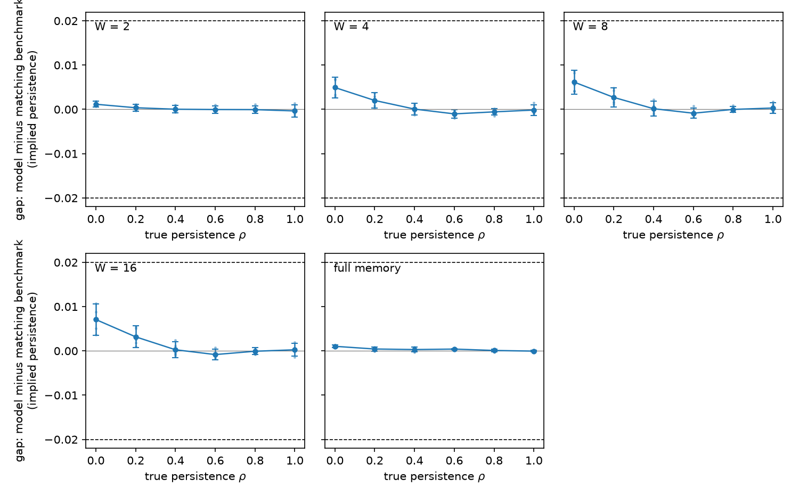
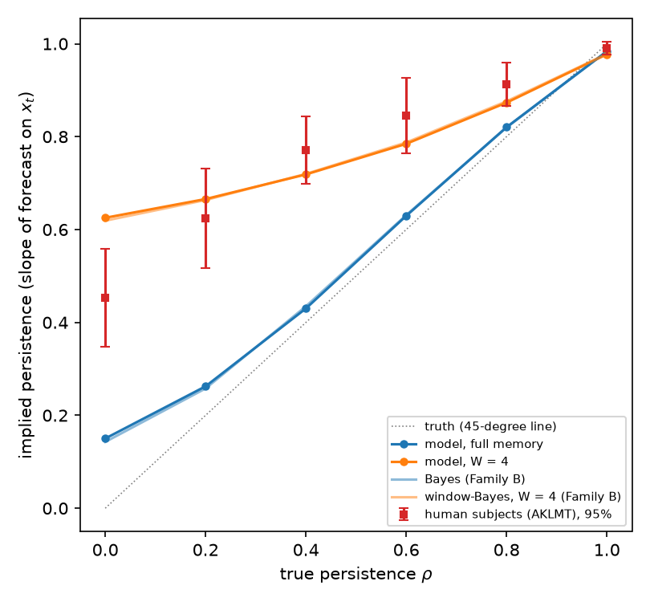
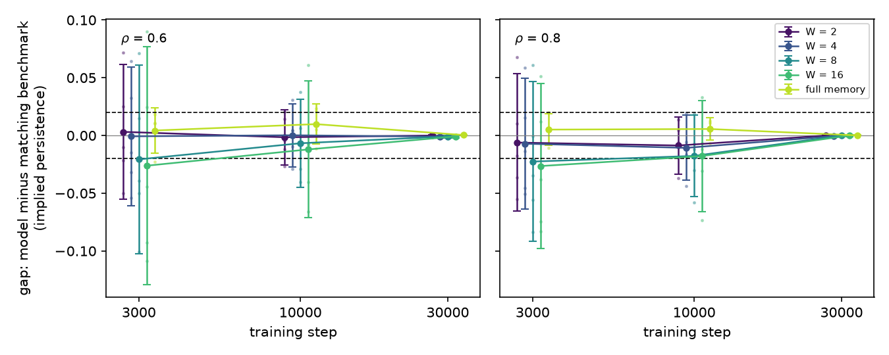
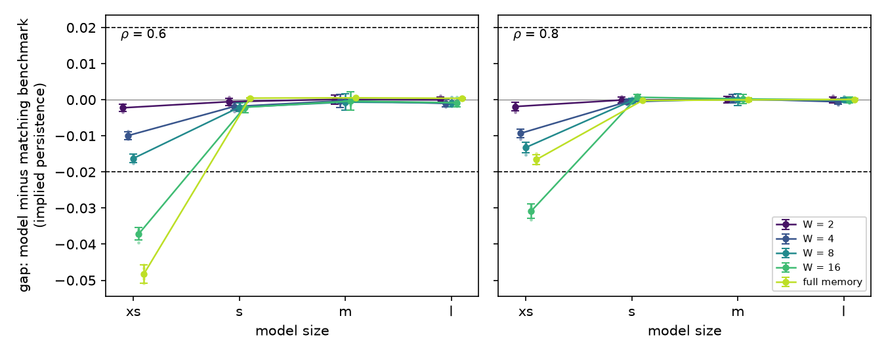

# Results

Generated by `python -m analysis.report` from `results/metrics`. Every number below is formatted by code from `results/summary.csv` and `results/hypotheses.json`. Decisions follow `docs/PREREG.md` sections 6 and 7 as written; nothing here goes beyond those readings. Gap is in slope units (margin 0.02); excess error is in percentage points (margin 1). Intervals are 95% Student-t intervals of the seed mean.

## Run status

Cells planned (Plan A, deviation prereg-v1.1): 96; complete through step 30000: 96; not run by design: 29; missing: 0; incomplete: 0.

## H1: the largest model with the full window is Bayes

Rows: family A, size l, full window, benchmark bayes, h = 1, step 30000.

**Decision: supported.**

| rho | column | n seeds | mean | sd | lo (95%) | hi (95%) | verdict | seed values |
|---|---|---|---|---|---|---|---|---|
| 0.0 | excess_mse_pct | 5 | +0.0284 | 0.0049 | +0.0223 | +0.0346 | equivalent | +0.0273, +0.0254, +0.0371, +0.0257, +0.0267 |
| 0.0 | gap | 5 | +0.0010 | 0.0002 | +0.0007 | +0.0013 | equivalent | +0.0008, +0.0009, +0.0014, +0.0011, +0.0010 |
| 0.2 | excess_mse_pct | 5 | -0.0039 | 0.0066 | -0.0121 | +0.0043 | equivalent | -0.0028, -0.0147, +0.0021, -0.0044, +0.0004 |
| 0.2 | gap | 5 | +0.0004 | 0.0004 | -0.0001 | +0.0009 | equivalent | +0.0006, -0.0001, +0.0009, +0.0001, +0.0006 |
| 0.4 | excess_mse_pct | 5 | +0.0098 | 0.0036 | +0.0053 | +0.0143 | equivalent | +0.0102, +0.0143, +0.0071, +0.0120, +0.0054 |
| 0.4 | gap | 5 | +0.0003 | 0.0004 | -0.0002 | +0.0008 | equivalent | +0.0004, -0.0003, +0.0008, +0.0001, +0.0005 |
| 0.6 | excess_mse_pct | 5 | -0.0019 | 0.0079 | -0.0118 | +0.0079 | equivalent | +0.0009, +0.0037, -0.0159, +0.0003, +0.0014 |
| 0.6 | gap | 5 | +0.0004 | 0.0001 | +0.0003 | +0.0006 | equivalent | +0.0006, +0.0002, +0.0004, +0.0004, +0.0004 |
| 0.8 | excess_mse_pct | 5 | -0.0032 | 0.0018 | -0.0055 | -0.0010 | equivalent | -0.0019, -0.0040, -0.0045, -0.0007, -0.0051 |
| 0.8 | gap | 5 | +0.0001 | 0.0002 | -0.0002 | +0.0004 | equivalent | +0.0003, +0.0001, -0.0003, +0.0001, +0.0003 |
| 1.0 | excess_mse_pct | 5 | +0.0120 | 0.0198 | -0.0126 | +0.0366 | equivalent | +0.0226, +0.0040, +0.0373, -0.0154, +0.0114 |
| 1.0 | gap | 5 | -0.0000 | 0.0001 | -0.0002 | +0.0001 | equivalent | -0.0001, +0.0000, -0.0002, +0.0001, -0.0000 |

Prior set (printed, not part of the decision):

| rho | column | n seeds | mean | sd | lo (95%) | hi (95%) | verdict | seed values |
|---|---|---|---|---|---|---|---|---|
| prior | excess_mse_pct | 5 | +0.0029 | 0.0005 | +0.0023 | +0.0036 | equivalent | +0.0036, +0.0028, +0.0028, +0.0033, +0.0023 |
| prior | gap | 5 | +0.0001 | 0.0001 | +0.0000 | +0.0002 | equivalent | +0.0002, +0.0000, +0.0001, +0.0002, +0.0002 |

## H2: window-limited models against window-Bayes

Rows: family A, benchmark window_bayes, h = 1, step 30000. Size l decides; other sizes are printed in the same tables and never enter a decision.

### Window 2

**Decision (size l): rational given its information.**

| size | rho | column | n seeds | mean | sd | lo (95%) | hi (95%) | verdict | seed values |
|---|---|---|---|---|---|---|---|---|---|
| l | 0.0 | excess_mse_pct | 5 | +0.0437 | 0.0449 | -0.0121 | +0.0994 | equivalent | +0.0005, +0.0951, +0.0891, +0.0210, +0.0125 |
| l | 0.0 | gap | 5 | +0.0012 | 0.0005 | +0.0005 | +0.0018 | equivalent | +0.0007, +0.0019, +0.0016, +0.0009, +0.0008 |
| l | 0.2 | excess_mse_pct | 5 | +0.0020 | 0.0395 | -0.0470 | +0.0510 | equivalent | -0.0400, +0.0283, +0.0563, -0.0112, -0.0233 |
| l | 0.2 | gap | 5 | +0.0004 | 0.0007 | -0.0005 | +0.0012 | equivalent | -0.0003, +0.0011, +0.0011, +0.0001, -0.0001 |
| l | 0.4 | excess_mse_pct | 5 | -0.0009 | 0.0244 | -0.0312 | +0.0294 | equivalent | -0.0187, -0.0070, +0.0416, -0.0056, -0.0148 |
| l | 0.4 | gap | 5 | +0.0000 | 0.0007 | -0.0008 | +0.0009 | equivalent | -0.0007, +0.0005, +0.0010, -0.0002, -0.0005 |
| l | 0.6 | excess_mse_pct | 5 | +0.0098 | 0.0162 | -0.0104 | +0.0299 | equivalent | +0.0251, -0.0167, +0.0144, +0.0069, +0.0191 |
| l | 0.6 | gap | 5 | -0.0000 | 0.0007 | -0.0009 | +0.0008 | equivalent | -0.0006, +0.0002, +0.0010, -0.0003, -0.0005 |
| l | 0.8 | excess_mse_pct | 5 | +0.0138 | 0.0423 | -0.0387 | +0.0664 | equivalent | +0.0547, -0.0158, -0.0343, +0.0038, +0.0608 |
| l | 0.8 | gap | 5 | -0.0001 | 0.0007 | -0.0009 | +0.0008 | equivalent | -0.0004, -0.0003, +0.0011, -0.0006, -0.0002 |
| l | 1.0 | excess_mse_pct | 5 | +0.0568 | 0.1995 | -0.1910 | +0.3045 | equivalent | +0.2062, +0.0707, -0.2285, +0.2725, -0.0372 |
| l | 1.0 | gap | 5 | -0.0004 | 0.0011 | -0.0018 | +0.0011 | equivalent | -0.0016, -0.0005, +0.0014, -0.0010, -0.0001 |
| xs | 0.0 | excess_mse_pct | 5 | +0.1136 | 0.0436 | +0.0595 | +0.1677 | equivalent | +0.0685, +0.1743, +0.1418, +0.0841, +0.0991 |
| xs | 0.0 | gap | 5 | +0.0029 | 0.0006 | +0.0021 | +0.0036 | equivalent | +0.0021, +0.0038, +0.0028, +0.0027, +0.0030 |
| xs | 0.2 | excess_mse_pct | 5 | -0.0414 | 0.0408 | -0.0920 | +0.0093 | equivalent | -0.0568, -0.0076, +0.0108, -0.0823, -0.0710 |
| xs | 0.2 | gap | 5 | +0.0008 | 0.0007 | -0.0000 | +0.0016 | equivalent | +0.0003, +0.0016, +0.0013, +0.0003, +0.0004 |
| xs | 0.4 | excess_mse_pct | 5 | -0.1141 | 0.0272 | -0.1478 | -0.0803 | equivalent | -0.1021, -0.1126, -0.0780, -0.1508, -0.1267 |
| xs | 0.4 | gap | 5 | -0.0009 | 0.0008 | -0.0018 | +0.0001 | equivalent | -0.0011, -0.0001, +0.0000, -0.0016, -0.0014 |
| xs | 0.6 | excess_mse_pct | 5 | -0.0824 | 0.0268 | -0.1156 | -0.0491 | equivalent | -0.0609, -0.1071, -0.0889, -0.1066, -0.0483 |
| xs | 0.6 | gap | 5 | -0.0022 | 0.0008 | -0.0033 | -0.0012 | equivalent | -0.0022, -0.0017, -0.0012, -0.0034, -0.0027 |
| xs | 0.8 | excess_mse_pct | 5 | +0.1707 | 0.0463 | +0.1132 | +0.2283 | equivalent | +0.1796, +0.1349, +0.1139, +0.1969, +0.2283 |
| xs | 0.8 | gap | 5 | -0.0019 | 0.0009 | -0.0030 | -0.0007 | equivalent | -0.0017, -0.0014, -0.0010, -0.0034, -0.0018 |
| xs | 1.0 | excess_mse_pct | 5 | +1.2558 | 0.5987 | +0.5124 | +1.9992 | inconclusive | +1.2765, +0.9953, +0.7756, +2.2775, +0.9542 |
| xs | 1.0 | gap | 5 | -0.0063 | 0.0019 | -0.0087 | -0.0039 | equivalent | -0.0065, -0.0053, -0.0049, -0.0095, -0.0051 |
| s | 0.0 | excess_mse_pct | 5 | +0.0298 | 0.0771 | -0.0659 | +0.1255 | equivalent | +0.0024, +0.0989, +0.1124, +0.0109, -0.0754 |
| s | 0.0 | gap | 5 | +0.0010 | 0.0011 | -0.0004 | +0.0023 | equivalent | +0.0007, +0.0022, +0.0018, +0.0007, -0.0005 |
| s | 0.2 | excess_mse_pct | 5 | -0.0237 | 0.0498 | -0.0855 | +0.0381 | equivalent | -0.0437, -0.0098, +0.0513, -0.0322, -0.0839 |
| s | 0.2 | gap | 5 | +0.0002 | 0.0010 | -0.0011 | +0.0014 | equivalent | -0.0002, +0.0010, +0.0013, -0.0001, -0.0012 |
| s | 0.4 | excess_mse_pct | 5 | -0.0339 | 0.0240 | -0.0637 | -0.0041 | equivalent | -0.0370, -0.0501, +0.0062, -0.0341, -0.0545 |
| s | 0.4 | gap | 5 | -0.0004 | 0.0009 | -0.0015 | +0.0008 | equivalent | -0.0007, +0.0000, +0.0009, -0.0005, -0.0016 |
| s | 0.6 | excess_mse_pct | 5 | +0.0062 | 0.0200 | -0.0186 | +0.0310 | equivalent | +0.0192, -0.0182, -0.0025, -0.0002, +0.0329 |
| s | 0.6 | gap | 5 | -0.0005 | 0.0008 | -0.0016 | +0.0005 | equivalent | -0.0008, -0.0004, +0.0007, -0.0007, -0.0015 |
| s | 0.8 | excess_mse_pct | 5 | +0.0740 | 0.0601 | -0.0007 | +0.1486 | equivalent | +0.0958, +0.0708, -0.0020, +0.0453, +0.1598 |
| s | 0.8 | gap | 5 | -0.0001 | 0.0007 | -0.0009 | +0.0007 | equivalent | -0.0001, -0.0000, +0.0010, -0.0008, -0.0005 |
| s | 1.0 | excess_mse_pct | 5 | +0.1043 | 0.1972 | -0.1405 | +0.3492 | equivalent | +0.2142, +0.0841, -0.1687, +0.3568, +0.0353 |
| s | 1.0 | gap | 5 | -0.0001 | 0.0009 | -0.0012 | +0.0011 | equivalent | -0.0007, -0.0003, +0.0014, -0.0009, +0.0001 |
| m | 0.0 | excess_mse_pct | 3 | +0.0739 | 0.0474 | -0.0439 | +0.1917 | equivalent | +0.0213, +0.1132, +0.0873 |
| m | 0.0 | gap | 3 | +0.0016 | 0.0007 | -0.0002 | +0.0034 | equivalent | +0.0009, +0.0023, +0.0015 |
| m | 0.2 | excess_mse_pct | 3 | +0.0145 | 0.0327 | -0.0668 | +0.0957 | equivalent | -0.0200, +0.0182, +0.0451 |
| m | 0.2 | gap | 3 | +0.0008 | 0.0007 | -0.0009 | +0.0024 | equivalent | +0.0000, +0.0013, +0.0011 |
| m | 0.4 | excess_mse_pct | 3 | -0.0104 | 0.0241 | -0.0703 | +0.0496 | equivalent | -0.0157, -0.0314, +0.0160 |
| m | 0.4 | gap | 3 | +0.0003 | 0.0006 | -0.0012 | +0.0018 | equivalent | -0.0003, +0.0005, +0.0008 |
| m | 0.6 | excess_mse_pct | 3 | -0.0060 | 0.0228 | -0.0627 | +0.0507 | equivalent | +0.0174, -0.0282, -0.0072 |
| m | 0.6 | gap | 3 | +0.0001 | 0.0005 | -0.0012 | +0.0013 | equivalent | -0.0003, -0.0001, +0.0006 |
| m | 0.8 | excess_mse_pct | 3 | +0.0118 | 0.0375 | -0.0813 | +0.1049 | equivalent | +0.0446, +0.0197, -0.0290 |
| m | 0.8 | gap | 3 | +0.0001 | 0.0004 | -0.0008 | +0.0010 | equivalent | -0.0001, -0.0001, +0.0005 |
| m | 1.0 | excess_mse_pct | 3 | +0.0367 | 0.1457 | -0.3253 | +0.3988 | equivalent | +0.1579, +0.0774, -0.1250 |
| m | 1.0 | gap | 3 | -0.0000 | 0.0012 | -0.0029 | +0.0028 | equivalent | -0.0011, -0.0003, +0.0012 |

Size l, prior set (printed, not part of the decision):

| rho | column | n seeds | mean | sd | lo (95%) | hi (95%) | verdict | seed values |
|---|---|---|---|---|---|---|---|---|
| prior | excess_mse_pct | 5 | +0.0094 | 0.0013 | +0.0077 | +0.0110 | equivalent | +0.0102, +0.0090, +0.0093, +0.0075, +0.0110 |
| prior | gap | 5 | +0.0000 | 0.0007 | -0.0009 | +0.0009 | equivalent | -0.0006, +0.0001, +0.0011, -0.0007, +0.0001 |

### Window 4

**Decision (size l): rational given its information.**

| size | rho | column | n seeds | mean | sd | lo (95%) | hi (95%) | verdict | seed values |
|---|---|---|---|---|---|---|---|---|---|
| l | 0.0 | excess_mse_pct | 5 | +0.2351 | 0.1215 | +0.0841 | +0.3860 | equivalent | +0.1289, +0.3671, +0.2499, +0.3358, +0.0936 |
| l | 0.0 | gap | 5 | +0.0049 | 0.0019 | +0.0026 | +0.0073 | equivalent | +0.0033, +0.0069, +0.0051, +0.0067, +0.0028 |
| l | 0.2 | excess_mse_pct | 5 | +0.0246 | 0.0594 | -0.0492 | +0.0984 | equivalent | -0.0227, +0.0975, +0.0567, +0.0398, -0.0483 |
| l | 0.2 | gap | 5 | +0.0020 | 0.0014 | +0.0003 | +0.0038 | equivalent | +0.0007, +0.0036, +0.0025, +0.0029, +0.0003 |
| l | 0.4 | excess_mse_pct | 5 | -0.0417 | 0.0206 | -0.0673 | -0.0162 | equivalent | -0.0474, -0.0242, -0.0161, -0.0600, -0.0609 |
| l | 0.4 | gap | 5 | +0.0001 | 0.0011 | -0.0013 | +0.0014 | equivalent | -0.0007, +0.0013, +0.0009, +0.0002, -0.0012 |
| l | 0.6 | excess_mse_pct | 5 | +0.0029 | 0.0346 | -0.0400 | +0.0458 | equivalent | +0.0418, -0.0467, -0.0060, -0.0035, +0.0290 |
| l | 0.6 | gap | 5 | -0.0010 | 0.0008 | -0.0020 | -0.0000 | equivalent | -0.0011, -0.0003, -0.0001, -0.0015, -0.0020 |
| l | 0.8 | excess_mse_pct | 5 | +0.1153 | 0.0679 | +0.0310 | +0.1996 | equivalent | +0.1378, +0.0370, +0.0515, +0.1586, +0.1918 |
| l | 0.8 | gap | 5 | -0.0006 | 0.0006 | -0.0013 | +0.0002 | equivalent | -0.0003, -0.0005, +0.0002, -0.0015, -0.0007 |
| l | 1.0 | excess_mse_pct | 5 | +0.0721 | 0.2003 | -0.1766 | +0.3208 | equivalent | +0.1435, +0.0567, -0.1896, +0.3560, -0.0060 |
| l | 1.0 | gap | 5 | -0.0002 | 0.0010 | -0.0014 | +0.0011 | equivalent | -0.0009, -0.0005, +0.0015, -0.0009, +0.0001 |
| xs | 0.0 | excess_mse_pct | 5 | +2.5954 | 0.1821 | +2.3693 | +2.8215 | different | +2.3290, +2.6597, +2.8317, +2.6013, +2.5554 |
| xs | 0.0 | gap | 5 | +0.0475 | 0.0028 | +0.0440 | +0.0509 | different | +0.0433, +0.0485, +0.0509, +0.0476, +0.0469 |
| xs | 0.2 | excess_mse_pct | 5 | +0.3125 | 0.0534 | +0.2462 | +0.3789 | equivalent | +0.2709, +0.3246, +0.3993, +0.2980, +0.2699 |
| xs | 0.2 | gap | 5 | +0.0210 | 0.0016 | +0.0190 | +0.0230 | inconclusive | +0.0191, +0.0214, +0.0235, +0.0208, +0.0203 |
| xs | 0.4 | excess_mse_pct | 5 | -0.4812 | 0.0245 | -0.5116 | -0.4508 | equivalent | -0.4423, -0.4753, -0.4913, -0.4899, -0.5071 |
| xs | 0.4 | gap | 5 | +0.0018 | 0.0008 | +0.0007 | +0.0028 | equivalent | +0.0019, +0.0018, +0.0031, +0.0012, +0.0009 |
| xs | 0.6 | excess_mse_pct | 5 | -0.1085 | 0.0289 | -0.1444 | -0.0726 | equivalent | -0.1387, -0.0867, -0.1416, -0.0894, -0.0861 |
| xs | 0.6 | gap | 5 | -0.0099 | 0.0009 | -0.0110 | -0.0088 | equivalent | -0.0087, -0.0100, -0.0094, -0.0108, -0.0107 |
| xs | 0.8 | excess_mse_pct | 5 | +1.0838 | 0.0945 | +0.9664 | +1.2011 | inconclusive | +0.9234, +1.0950, +1.1057, +1.1219, +1.1729 |
| xs | 0.8 | gap | 5 | -0.0093 | 0.0010 | -0.0105 | -0.0081 | equivalent | -0.0083, -0.0096, -0.0087, -0.0108, -0.0090 |
| xs | 1.0 | excess_mse_pct | 5 | +1.6927 | 0.5493 | +1.0107 | +2.3747 | different | +1.3863, +1.5979, +1.3357, +2.6588, +1.4848 |
| xs | 1.0 | gap | 5 | -0.0060 | 0.0019 | -0.0085 | -0.0036 | equivalent | -0.0059, -0.0053, -0.0049, -0.0094, -0.0047 |
| s | 0.0 | excess_mse_pct | 5 | +0.1808 | 0.1038 | +0.0519 | +0.3096 | equivalent | +0.1608, +0.2863, +0.2813, +0.1332, +0.0422 |
| s | 0.0 | gap | 5 | +0.0044 | 0.0016 | +0.0024 | +0.0064 | equivalent | +0.0043, +0.0063, +0.0057, +0.0034, +0.0023 |
| s | 0.2 | excess_mse_pct | 5 | -0.0428 | 0.0546 | -0.1106 | +0.0249 | equivalent | -0.0664, +0.0048, +0.0158, -0.0509, -0.1175 |
| s | 0.2 | gap | 5 | +0.0011 | 0.0015 | -0.0008 | +0.0029 | equivalent | +0.0008, +0.0025, +0.0025, +0.0003, -0.0009 |
| s | 0.4 | excess_mse_pct | 5 | -0.0856 | 0.0107 | -0.0989 | -0.0722 | equivalent | -0.0871, -0.0875, -0.0765, -0.0749, -0.1017 |
| s | 0.4 | gap | 5 | -0.0011 | 0.0012 | -0.0025 | +0.0003 | equivalent | -0.0013, -0.0001, +0.0001, -0.0015, -0.0027 |
| s | 0.6 | excess_mse_pct | 5 | +0.0297 | 0.0334 | -0.0117 | +0.0712 | equivalent | +0.0596, -0.0137, +0.0042, +0.0378, +0.0608 |
| s | 0.6 | gap | 5 | -0.0019 | 0.0008 | -0.0029 | -0.0008 | equivalent | -0.0018, -0.0014, -0.0009, -0.0021, -0.0032 |
| s | 0.8 | excess_mse_pct | 5 | +0.1692 | 0.0560 | +0.0996 | +0.2387 | equivalent | +0.1843, +0.1252, +0.1284, +0.1479, +0.2601 |
| s | 0.8 | gap | 5 | -0.0006 | 0.0006 | -0.0013 | +0.0001 | equivalent | -0.0001, -0.0006, +0.0001, -0.0012, -0.0011 |
| s | 1.0 | excess_mse_pct | 5 | +0.1594 | 0.2122 | -0.1040 | +0.4229 | equivalent | +0.2291, +0.1607, -0.1477, +0.4403, +0.1147 |
| s | 1.0 | gap | 5 | -0.0006 | 0.0009 | -0.0018 | +0.0005 | equivalent | -0.0010, -0.0009, +0.0008, -0.0017, -0.0003 |
| m | 0.0 | excess_mse_pct | 3 | +0.2271 | 0.0788 | +0.0313 | +0.4229 | equivalent | +0.1385, +0.2893, +0.2535 |
| m | 0.0 | gap | 3 | +0.0048 | 0.0011 | +0.0021 | +0.0076 | equivalent | +0.0036, +0.0058, +0.0051 |
| m | 0.2 | excess_mse_pct | 3 | +0.0313 | 0.0567 | -0.1097 | +0.1723 | equivalent | -0.0341, +0.0674, +0.0606 |
| m | 0.2 | gap | 3 | +0.0020 | 0.0013 | -0.0011 | +0.0052 | equivalent | +0.0006, +0.0031, +0.0024 |
| m | 0.4 | excess_mse_pct | 3 | -0.0314 | 0.0190 | -0.0786 | +0.0158 | equivalent | -0.0455, -0.0389, -0.0098 |
| m | 0.4 | gap | 3 | +0.0004 | 0.0011 | -0.0023 | +0.0032 | equivalent | -0.0008, +0.0012, +0.0009 |
| m | 0.6 | excess_mse_pct | 3 | +0.0001 | 0.0425 | -0.1056 | +0.1058 | equivalent | +0.0437, -0.0413, -0.0022 |
| m | 0.6 | gap | 3 | -0.0003 | 0.0007 | -0.0021 | +0.0015 | equivalent | -0.0011, +0.0000, +0.0002 |
| m | 0.8 | excess_mse_pct | 3 | +0.0589 | 0.0533 | -0.0735 | +0.1912 | equivalent | +0.1203, +0.0258, +0.0304 |
| m | 0.8 | gap | 3 | +0.0003 | 0.0004 | -0.0008 | +0.0014 | equivalent | -0.0001, +0.0002, +0.0008 |
| m | 1.0 | excess_mse_pct | 3 | -0.0234 | 0.1821 | -0.4758 | +0.4290 | equivalent | +0.1429, +0.0049, -0.2180 |
| m | 1.0 | gap | 3 | -0.0003 | 0.0009 | -0.0026 | +0.0020 | equivalent | -0.0010, -0.0006, +0.0008 |

Size l, prior set (printed, not part of the decision):

| rho | column | n seeds | mean | sd | lo (95%) | hi (95%) | verdict | seed values |
|---|---|---|---|---|---|---|---|---|
| prior | excess_mse_pct | 5 | +0.0473 | 0.0192 | +0.0235 | +0.0711 | equivalent | +0.0348, +0.0471, +0.0372, +0.0805, +0.0370 |
| prior | gap | 5 | +0.0001 | 0.0007 | -0.0007 | +0.0009 | equivalent | -0.0003, +0.0005, +0.0010, -0.0006, -0.0000 |

### Window 8

**Decision (size l): rational given its information.**

| size | rho | column | n seeds | mean | sd | lo (95%) | hi (95%) | verdict | seed values |
|---|---|---|---|---|---|---|---|---|---|
| l | 0.0 | excess_mse_pct | 5 | +0.2681 | 0.1078 | +0.1343 | +0.4019 | equivalent | +0.2188, +0.3884, +0.3789, +0.1969, +0.1576 |
| l | 0.0 | gap | 5 | +0.0062 | 0.0022 | +0.0035 | +0.0089 | equivalent | +0.0056, +0.0087, +0.0082, +0.0042, +0.0042 |
| l | 0.2 | excess_mse_pct | 5 | +0.0194 | 0.0527 | -0.0460 | +0.0849 | equivalent | -0.0186, +0.0413, +0.0976, +0.0125, -0.0356 |
| l | 0.2 | gap | 5 | +0.0027 | 0.0017 | +0.0006 | +0.0048 | equivalent | +0.0018, +0.0042, +0.0049, +0.0015, +0.0011 |
| l | 0.4 | excess_mse_pct | 5 | -0.0624 | 0.0299 | -0.0996 | -0.0253 | equivalent | -0.0618, -0.1041, -0.0331, -0.0352, -0.0778 |
| l | 0.4 | gap | 5 | +0.0002 | 0.0014 | -0.0015 | +0.0018 | equivalent | -0.0007, +0.0007, +0.0022, -0.0004, -0.0011 |
| l | 0.6 | excess_mse_pct | 5 | -0.0038 | 0.0475 | -0.0628 | +0.0552 | equivalent | +0.0395, -0.0595, -0.0513, +0.0277, +0.0245 |
| l | 0.6 | gap | 5 | -0.0009 | 0.0009 | -0.0020 | +0.0003 | equivalent | -0.0013, -0.0012, +0.0007, -0.0009, -0.0017 |
| l | 0.8 | excess_mse_pct | 5 | +0.0887 | 0.0674 | +0.0051 | +0.1724 | equivalent | +0.1140, +0.0836, -0.0086, +0.0771, +0.1775 |
| l | 0.8 | gap | 5 | -0.0000 | 0.0005 | -0.0006 | +0.0006 | equivalent | -0.0002, -0.0005, +0.0008, -0.0000, -0.0001 |
| l | 1.0 | excess_mse_pct | 5 | -0.0197 | 0.1659 | -0.2257 | +0.1862 | equivalent | +0.1384, -0.0244, -0.2393, +0.1449, -0.1183 |
| l | 1.0 | gap | 5 | +0.0003 | 0.0010 | -0.0009 | +0.0016 | equivalent | -0.0005, -0.0002, +0.0017, -0.0005, +0.0010 |
| xs | 0.0 | excess_mse_pct | 5 | +3.6151 | 0.1006 | +3.4902 | +3.7399 | different | +3.5796, +3.6819, +3.7508, +3.4974, +3.5656 |
| xs | 0.0 | gap | 5 | +0.0704 | 0.0015 | +0.0685 | +0.0723 | different | +0.0697, +0.0714, +0.0726, +0.0687, +0.0698 |
| xs | 0.2 | excess_mse_pct | 5 | +0.5571 | 0.0468 | +0.4990 | +0.6152 | equivalent | +0.5618, +0.5709, +0.6211, +0.4928, +0.5391 |
| xs | 0.2 | gap | 5 | +0.0341 | 0.0013 | +0.0324 | +0.0357 | different | +0.0338, +0.0347, +0.0358, +0.0323, +0.0337 |
| xs | 0.4 | excess_mse_pct | 5 | -0.6124 | 0.0191 | -0.6361 | -0.5888 | equivalent | -0.5802, -0.6248, -0.6181, -0.6275, -0.6116 |
| xs | 0.4 | gap | 5 | +0.0036 | 0.0010 | +0.0023 | +0.0049 | equivalent | +0.0038, +0.0039, +0.0049, +0.0020, +0.0034 |
| xs | 0.6 | excess_mse_pct | 5 | -0.0192 | 0.0255 | -0.0509 | +0.0125 | equivalent | +0.0108, -0.0363, -0.0535, -0.0073, -0.0097 |
| xs | 0.6 | gap | 5 | -0.0162 | 0.0010 | -0.0174 | -0.0150 | equivalent | -0.0154, -0.0165, -0.0153, -0.0177, -0.0163 |
| xs | 0.8 | excess_mse_pct | 5 | +1.6673 | 0.0380 | +1.6201 | +1.7145 | different | +1.6157, +1.6873, +1.6400, +1.6864, +1.7072 |
| xs | 0.8 | gap | 5 | -0.0132 | 0.0012 | -0.0147 | -0.0117 | equivalent | -0.0125, -0.0137, -0.0123, -0.0152, -0.0125 |
| xs | 1.0 | excess_mse_pct | 5 | +1.7983 | 0.3730 | +1.3352 | +2.2615 | different | +1.4545, +1.7674, +1.4899, +2.3732, +1.9067 |
| xs | 1.0 | gap | 5 | -0.0059 | 0.0017 | -0.0081 | -0.0038 | equivalent | -0.0037, -0.0060, -0.0050, -0.0083, -0.0067 |
| s | 0.0 | excess_mse_pct | 5 | +0.3193 | 0.1177 | +0.1732 | +0.4654 | equivalent | +0.2584, +0.4654, +0.4125, +0.2840, +0.1765 |
| s | 0.0 | gap | 5 | +0.0063 | 0.0022 | +0.0036 | +0.0091 | equivalent | +0.0052, +0.0091, +0.0082, +0.0054, +0.0038 |
| s | 0.2 | excess_mse_pct | 5 | +0.0260 | 0.0557 | -0.0431 | +0.0951 | equivalent | -0.0096, +0.0778, +0.0830, +0.0249, -0.0461 |
| s | 0.2 | gap | 5 | +0.0028 | 0.0018 | +0.0005 | +0.0051 | equivalent | +0.0020, +0.0050, +0.0044, +0.0021, +0.0006 |
| s | 0.4 | excess_mse_pct | 5 | -0.1009 | 0.0241 | -0.1308 | -0.0710 | equivalent | -0.1157, -0.1235, -0.0723, -0.0773, -0.1156 |
| s | 0.4 | gap | 5 | -0.0006 | 0.0015 | -0.0024 | +0.0012 | equivalent | -0.0013, +0.0008, +0.0009, -0.0010, -0.0025 |
| s | 0.6 | excess_mse_pct | 5 | -0.0077 | 0.0433 | -0.0614 | +0.0461 | equivalent | +0.0078, -0.0648, -0.0373, +0.0111, +0.0448 |
| s | 0.6 | gap | 5 | -0.0021 | 0.0010 | -0.0033 | -0.0009 | equivalent | -0.0026, -0.0015, -0.0008, -0.0021, -0.0033 |
| s | 0.8 | excess_mse_pct | 5 | +0.1401 | 0.0648 | +0.0597 | +0.2205 | equivalent | +0.1720, +0.0960, +0.0797, +0.1151, +0.2377 |
| s | 0.8 | gap | 5 | -0.0003 | 0.0005 | -0.0009 | +0.0004 | equivalent | -0.0005, -0.0000, +0.0005, -0.0007, -0.0005 |
| s | 1.0 | excess_mse_pct | 5 | +0.0986 | 0.2164 | -0.1701 | +0.3673 | equivalent | +0.2825, +0.1823, -0.2288, +0.2654, -0.0083 |
| s | 1.0 | gap | 5 | -0.0006 | 0.0013 | -0.0022 | +0.0010 | equivalent | -0.0019, -0.0015, +0.0012, -0.0012, +0.0004 |
| m | 0.0 | excess_mse_pct | 3 | +0.2905 | 0.0917 | +0.0626 | +0.5184 | equivalent | +0.1848, +0.3372, +0.3494 |
| m | 0.0 | gap | 3 | +0.0062 | 0.0016 | +0.0022 | +0.0101 | equivalent | +0.0044, +0.0067, +0.0074 |
| m | 0.2 | excess_mse_pct | 3 | +0.0342 | 0.0537 | -0.0992 | +0.1675 | equivalent | -0.0278, +0.0626, +0.0676 |
| m | 0.2 | gap | 3 | +0.0033 | 0.0017 | -0.0008 | +0.0074 | equivalent | +0.0014, +0.0040, +0.0045 |
| m | 0.4 | excess_mse_pct | 3 | -0.0746 | 0.0137 | -0.1087 | -0.0405 | equivalent | -0.0767, -0.0871, -0.0599 |
| m | 0.4 | gap | 3 | +0.0006 | 0.0014 | -0.0028 | +0.0040 | equivalent | -0.0009, +0.0011, +0.0017 |
| m | 0.6 | excess_mse_pct | 3 | -0.0331 | 0.0483 | -0.1530 | +0.0868 | equivalent | +0.0206, -0.0728, -0.0470 |
| m | 0.6 | gap | 3 | -0.0006 | 0.0009 | -0.0029 | +0.0016 | equivalent | -0.0015, -0.0008, +0.0003 |
| m | 0.8 | excess_mse_pct | 3 | +0.0572 | 0.0519 | -0.0719 | +0.1862 | equivalent | +0.1157, +0.0393, +0.0165 |
| m | 0.8 | gap | 3 | -0.0000 | 0.0007 | -0.0016 | +0.0016 | equivalent | -0.0002, -0.0005, +0.0007 |
| m | 1.0 | excess_mse_pct | 3 | -0.0224 | 0.1687 | -0.4415 | +0.3966 | equivalent | +0.1110, +0.0337, -0.2120 |
| m | 1.0 | gap | 3 | +0.0000 | 0.0011 | -0.0026 | +0.0027 | equivalent | -0.0004, -0.0008, +0.0012 |

Size l, prior set (printed, not part of the decision):

| rho | column | n seeds | mean | sd | lo (95%) | hi (95%) | verdict | seed values |
|---|---|---|---|---|---|---|---|---|
| prior | excess_mse_pct | 5 | +0.0345 | 0.0041 | +0.0293 | +0.0396 | equivalent | +0.0392, +0.0335, +0.0282, +0.0347, +0.0367 |
| prior | gap | 5 | +0.0005 | 0.0008 | -0.0004 | +0.0015 | equivalent | -0.0001, +0.0007, +0.0018, -0.0001, +0.0005 |

### Window 16

**Decision (size l): rational given its information.**

| size | rho | column | n seeds | mean | sd | lo (95%) | hi (95%) | verdict | seed values |
|---|---|---|---|---|---|---|---|---|---|
| l | 0.0 | excess_mse_pct | 5 | +0.2815 | 0.1148 | +0.1390 | +0.4240 | equivalent | +0.2694, +0.4127, +0.3823, +0.1937, +0.1495 |
| l | 0.0 | gap | 5 | +0.0071 | 0.0028 | +0.0036 | +0.0106 | equivalent | +0.0072, +0.0107, +0.0088, +0.0051, +0.0036 |
| l | 0.2 | excess_mse_pct | 5 | +0.0266 | 0.0485 | -0.0336 | +0.0867 | equivalent | -0.0022, +0.0535, +0.0994, -0.0103, -0.0076 |
| l | 0.2 | gap | 5 | +0.0032 | 0.0020 | +0.0007 | +0.0056 | equivalent | +0.0025, +0.0050, +0.0055, +0.0019, +0.0010 |
| l | 0.4 | excess_mse_pct | 5 | -0.0315 | 0.0137 | -0.0485 | -0.0145 | equivalent | -0.0513, -0.0362, -0.0143, -0.0300, -0.0258 |
| l | 0.4 | gap | 5 | +0.0003 | 0.0015 | -0.0016 | +0.0021 | equivalent | -0.0006, +0.0011, +0.0025, -0.0007, -0.0010 |
| l | 0.6 | excess_mse_pct | 5 | +0.0239 | 0.0345 | -0.0189 | +0.0668 | equivalent | +0.0499, +0.0128, -0.0316, +0.0492, +0.0395 |
| l | 0.6 | gap | 5 | -0.0008 | 0.0010 | -0.0020 | +0.0004 | equivalent | -0.0018, -0.0007, +0.0008, -0.0010, -0.0014 |
| l | 0.8 | excess_mse_pct | 5 | +0.0607 | 0.0441 | +0.0060 | +0.1155 | equivalent | +0.0964, +0.0387, -0.0039, +0.0697, +0.1028 |
| l | 0.8 | gap | 5 | -0.0001 | 0.0006 | -0.0009 | +0.0007 | equivalent | -0.0006, -0.0008, +0.0006, +0.0003, +0.0002 |
| l | 1.0 | excess_mse_pct | 5 | -0.0135 | 0.1915 | -0.2513 | +0.2243 | equivalent | +0.0913, +0.0282, -0.2642, +0.2199, -0.1426 |
| l | 1.0 | gap | 5 | +0.0003 | 0.0012 | -0.0012 | +0.0017 | equivalent | +0.0001, +0.0000, +0.0019, -0.0014, +0.0006 |
| xs | 0.0 | excess_mse_pct | 5 | +7.6319 | 0.4620 | +7.0582 | +8.2055 | different | +7.7628, +7.3797, +7.3987, +7.2364, +8.3817 |
| xs | 0.0 | gap | 5 | +0.1427 | 0.0058 | +0.1355 | +0.1499 | different | +0.1449, +0.1396, +0.1400, +0.1372, +0.1518 |
| xs | 0.2 | excess_mse_pct | 5 | +1.6092 | 0.1082 | +1.4748 | +1.7436 | different | +1.6615, +1.5544, +1.5554, +1.5019, +1.7727 |
| xs | 0.2 | gap | 5 | +0.0775 | 0.0027 | +0.0741 | +0.0809 | different | +0.0795, +0.0763, +0.0766, +0.0741, +0.0810 |
| xs | 0.4 | excess_mse_pct | 5 | -0.9179 | 0.0297 | -0.9548 | -0.8811 | equivalent | -0.9385, -0.9027, -0.9040, -0.8859, -0.9585 |
| xs | 0.4 | gap | 5 | +0.0107 | 0.0009 | +0.0096 | +0.0119 | equivalent | +0.0119, +0.0110, +0.0111, +0.0094, +0.0102 |
| xs | 0.6 | excess_mse_pct | 5 | +0.3070 | 0.0318 | +0.2675 | +0.3465 | equivalent | +0.2568, +0.3208, +0.2985, +0.3407, +0.3182 |
| xs | 0.6 | gap | 5 | -0.0372 | 0.0014 | -0.0389 | -0.0355 | different | -0.0370, -0.0359, -0.0364, -0.0372, -0.0395 |
| xs | 0.8 | excess_mse_pct | 5 | +3.4577 | 0.1130 | +3.3174 | +3.5980 | different | +3.4314, +3.3885, +3.4509, +3.3670, +3.6508 |
| xs | 0.8 | gap | 5 | -0.0309 | 0.0016 | -0.0329 | -0.0288 | different | -0.0308, -0.0297, -0.0291, -0.0314, -0.0332 |
| xs | 1.0 | excess_mse_pct | 5 | +2.8490 | 0.3934 | +2.3605 | +3.3376 | different | +2.5960, +3.0248, +2.2870, +3.2128, +3.1246 |
| xs | 1.0 | gap | 5 | -0.0071 | 0.0011 | -0.0085 | -0.0057 | equivalent | -0.0063, -0.0084, -0.0059, -0.0083, -0.0068 |
| s | 0.0 | excess_mse_pct | 5 | +0.3285 | 0.0887 | +0.2184 | +0.4387 | equivalent | +0.3094, +0.4206, +0.3979, +0.3194, +0.1954 |
| s | 0.0 | gap | 5 | +0.0076 | 0.0019 | +0.0052 | +0.0100 | equivalent | +0.0077, +0.0094, +0.0087, +0.0077, +0.0043 |
| s | 0.2 | excess_mse_pct | 5 | +0.0189 | 0.0471 | -0.0395 | +0.0774 | equivalent | -0.0105, +0.0542, +0.0841, -0.0185, -0.0145 |
| s | 0.2 | gap | 5 | +0.0033 | 0.0017 | +0.0012 | +0.0055 | equivalent | +0.0029, +0.0051, +0.0050, +0.0026, +0.0010 |
| s | 0.4 | excess_mse_pct | 5 | -0.0672 | 0.0260 | -0.0995 | -0.0350 | equivalent | -0.0930, -0.0802, -0.0281, -0.0802, -0.0547 |
| s | 0.4 | gap | 5 | -0.0013 | 0.0015 | -0.0032 | +0.0006 | equivalent | -0.0018, -0.0000, +0.0007, -0.0024, -0.0028 |
| s | 0.6 | excess_mse_pct | 5 | +0.0563 | 0.0313 | +0.0175 | +0.0951 | equivalent | +0.0583, +0.0173, +0.0342, +0.0775, +0.0944 |
| s | 0.6 | gap | 5 | -0.0021 | 0.0012 | -0.0036 | -0.0006 | equivalent | -0.0029, -0.0015, -0.0003, -0.0030, -0.0028 |
| s | 0.8 | excess_mse_pct | 5 | +0.1083 | 0.0530 | +0.0425 | +0.1741 | equivalent | +0.1394, +0.0828, +0.0270, +0.1380, +0.1545 |
| s | 0.8 | gap | 5 | +0.0007 | 0.0006 | -0.0001 | +0.0014 | equivalent | +0.0002, +0.0008, +0.0015, +0.0000, +0.0010 |
| s | 1.0 | excess_mse_pct | 5 | +0.0565 | 0.1777 | -0.1641 | +0.2771 | equivalent | +0.1862, +0.0660, -0.2125, +0.2409, +0.0017 |
| s | 1.0 | gap | 5 | -0.0007 | 0.0008 | -0.0017 | +0.0004 | equivalent | -0.0016, -0.0006, +0.0006, -0.0011, -0.0006 |
| m | 0.0 | excess_mse_pct | 3 | +0.2899 | 0.0593 | +0.1427 | +0.4371 | equivalent | +0.2275, +0.2966, +0.3455 |
| m | 0.0 | gap | 3 | +0.0067 | 0.0007 | +0.0050 | +0.0084 | equivalent | +0.0060, +0.0067, +0.0074 |
| m | 0.2 | excess_mse_pct | 3 | +0.0354 | 0.0525 | -0.0950 | +0.1658 | equivalent | -0.0226, +0.0493, +0.0796 |
| m | 0.2 | gap | 3 | +0.0037 | 0.0013 | +0.0004 | +0.0070 | equivalent | +0.0022, +0.0040, +0.0048 |
| m | 0.4 | excess_mse_pct | 3 | -0.0436 | 0.0119 | -0.0731 | -0.0141 | equivalent | -0.0547, -0.0449, -0.0311 |
| m | 0.4 | gap | 3 | +0.0005 | 0.0014 | -0.0030 | +0.0041 | equivalent | -0.0011, +0.0010, +0.0017 |
| m | 0.6 | excess_mse_pct | 3 | +0.0073 | 0.0389 | -0.0893 | +0.1038 | equivalent | +0.0521, -0.0171, -0.0131 |
| m | 0.6 | gap | 3 | -0.0004 | 0.0010 | -0.0029 | +0.0022 | equivalent | -0.0014, -0.0004, +0.0007 |
| m | 0.8 | excess_mse_pct | 3 | +0.0121 | 0.0554 | -0.1256 | +0.1498 | equivalent | +0.0726, +0.0000, -0.0363 |
| m | 0.8 | gap | 3 | +0.0002 | 0.0005 | -0.0010 | +0.0015 | equivalent | +0.0003, -0.0003, +0.0007 |
| m | 1.0 | excess_mse_pct | 3 | -0.0713 | 0.1745 | -0.5048 | +0.3623 | equivalent | -0.0072, +0.0622, -0.2688 |
| m | 1.0 | gap | 3 | +0.0005 | 0.0012 | -0.0024 | +0.0035 | equivalent | +0.0004, -0.0006, +0.0017 |

Size l, prior set (printed, not part of the decision):

| rho | column | n seeds | mean | sd | lo (95%) | hi (95%) | verdict | seed values |
|---|---|---|---|---|---|---|---|---|
| prior | excess_mse_pct | 5 | +0.0426 | 0.0126 | +0.0270 | +0.0582 | equivalent | +0.0494, +0.0615, +0.0352, +0.0346, +0.0323 |
| prior | gap | 5 | +0.0005 | 0.0008 | -0.0005 | +0.0016 | equivalent | -0.0001, +0.0006, +0.0019, -0.0002, +0.0005 |

## H3: overreaction where the matched Bayesian underreacts

Rows: family A, size l, benchmark window_bayes, h = 1, step 30000, rho in 0.6, 0.8, column gap. A combination is positive at 95% if the lower end of its 95% interval is above +0.02, and positive after adjustment if mean minus 5.261 sd / sqrt(n) (n = 5) is above +0.02. The denominator is always 8.

**Decision: not supported.** 0 of 8 positive at 95%, none after adjustment.

| window | rho | n seeds | mean | sd | lo (95%) | lo (adjusted) | positive at 95% | positive after adjustment | seed values |
|---|---|---|---|---|---|---|---|---|---|
| 2 | 0.6 | 5 | -0.0000 | 0.0007 | -0.0009 | -0.0016 | no | no | -0.0006, +0.0002, +0.0010, -0.0003, -0.0005 |
| 2 | 0.8 | 5 | -0.0001 | 0.0007 | -0.0009 | -0.0016 | no | no | -0.0004, -0.0003, +0.0011, -0.0006, -0.0002 |
| 4 | 0.6 | 5 | -0.0010 | 0.0008 | -0.0020 | -0.0029 | no | no | -0.0011, -0.0003, -0.0001, -0.0015, -0.0020 |
| 4 | 0.8 | 5 | -0.0006 | 0.0006 | -0.0013 | -0.0020 | no | no | -0.0003, -0.0005, +0.0002, -0.0015, -0.0007 |
| 8 | 0.6 | 5 | -0.0009 | 0.0009 | -0.0020 | -0.0031 | no | no | -0.0013, -0.0012, +0.0007, -0.0009, -0.0017 |
| 8 | 0.8 | 5 | -0.0000 | 0.0005 | -0.0006 | -0.0012 | no | no | -0.0002, -0.0005, +0.0008, -0.0000, -0.0001 |
| 16 | 0.6 | 5 | -0.0008 | 0.0010 | -0.0020 | -0.0031 | no | no | -0.0018, -0.0007, +0.0008, -0.0010, -0.0014 |
| 16 | 0.8 | 5 | -0.0001 | 0.0006 | -0.0009 | -0.0016 | no | no | -0.0006, -0.0008, +0.0006, +0.0003, +0.0002 |

Other sizes (descriptive, positives at 95%):

| size | combinations present | not run or incomplete | positive at 95% |
|---|---|---|---|
| xs | 8 | 0 | 0 |
| s | 8 | 0 | 0 |
| m | 8 | 0 | 0 |

Across xs, s and m: 0 of 24 positive at 95%; 0 of 24 not run or incomplete.

## Flagged findings and the training-length check

No size-l finding is flagged.

## Cells not run

Not run by design (Plan A): A/B-m-w2 (family A): seeds 3,4; A/B-m-w4 (family A): seeds 3,4; A/B-m-w8 (family A): seeds 3,4; A/B-m-w16 (family A): seeds 3,4; A/B-m-wfull (family A): seeds 3,4; A/B-l-w2 (family B): seeds 0,1,2,3,4; A/B-l-w4 (family B): seeds 3,4; A/B-l-w8 (family B): seeds 0,1,2,3,4; A/B-l-w16 (family B): seeds 0,1,2,3,4; A/B-l-wfull (family B): seeds 3,4.

Not run or incomplete (planned, no complete metrics file): none.

## Deviations

Every deviation from `docs/PREREG.md` is logged in [docs/DECISIONS.md](docs/DECISIONS.md). The grid change (deviation prereg-v1.1, Plan A) was decided before any confirmatory run existed.

## Descriptive tables

### Convergence (descriptive; never changes a verdict)

| family | size | window | runs present | runs converged | runs expected | cell converged |
|---|---|---|---|---|---|---|
| A | l | 16 | 5 | 0 | 5 | no |
| A | l | 2 | 5 | 1 | 5 | no |
| A | l | 4 | 5 | 0 | 5 | no |
| A | l | 8 | 5 | 0 | 5 | no |
| A | l | full | 5 | 3 | 5 | no |
| A | m | 16 | 3 | 0 | 3 | no |
| A | m | 2 | 3 | 0 | 3 | no |
| A | m | 4 | 3 | 0 | 3 | no |
| A | m | 8 | 3 | 0 | 3 | no |
| A | m | full | 3 | 2 | 3 | no |
| A | s | 16 | 5 | 0 | 5 | no |
| A | s | 2 | 5 | 2 | 5 | no |
| A | s | 4 | 5 | 0 | 5 | no |
| A | s | 8 | 5 | 0 | 5 | no |
| A | s | full | 5 | 2 | 5 | no |
| A | xs | 16 | 5 | 0 | 5 | no |
| A | xs | 2 | 5 | 1 | 5 | no |
| A | xs | 4 | 5 | 0 | 5 | no |
| A | xs | 8 | 5 | 0 | 5 | no |
| A | xs | full | 5 | 1 | 5 | no |
| B | l | 4 | 3 | 0 | 3 | no |
| B | l | full | 3 | 0 | 3 | no |

Per run (steps present in the metrics file; converged flag):

| cell | steps | converged |
|---|---|---|
| A-l-w16-s0 | 3000, 10000, 30000 | no |
| A-l-w16-s1 | 3000, 10000, 30000 | no |
| A-l-w16-s2 | 3000, 10000, 30000 | no |
| A-l-w16-s3 | 3000, 10000, 30000 | no |
| A-l-w16-s4 | 3000, 10000, 30000 | no |
| A-l-w2-s0 | 3000, 10000, 30000 | no |
| A-l-w2-s1 | 3000, 10000, 30000 | no |
| A-l-w2-s2 | 3000, 10000, 30000 | no |
| A-l-w2-s3 | 3000, 10000, 30000 | no |
| A-l-w2-s4 | 3000, 10000, 30000 | yes |
| A-l-w4-s0 | 3000, 10000, 30000 | no |
| A-l-w4-s1 | 3000, 10000, 30000 | no |
| A-l-w4-s2 | 3000, 10000, 30000 | no |
| A-l-w4-s3 | 3000, 10000, 30000 | no |
| A-l-w4-s4 | 3000, 10000, 30000 | no |
| A-l-w8-s0 | 3000, 10000, 30000 | no |
| A-l-w8-s1 | 3000, 10000, 30000 | no |
| A-l-w8-s2 | 3000, 10000, 30000 | no |
| A-l-w8-s3 | 3000, 10000, 30000 | no |
| A-l-w8-s4 | 3000, 10000, 30000 | no |
| A-l-wfull-s0 | 3000, 10000, 30000 | no |
| A-l-wfull-s1 | 3000, 10000, 30000 | yes |
| A-l-wfull-s2 | 3000, 10000, 30000 | yes |
| A-l-wfull-s3 | 3000, 10000, 30000 | no |
| A-l-wfull-s4 | 3000, 10000, 30000 | yes |
| A-m-w16-s0 | 3000, 10000, 30000 | no |
| A-m-w16-s1 | 3000, 10000, 30000 | no |
| A-m-w16-s2 | 3000, 10000, 30000 | no |
| A-m-w2-s0 | 3000, 10000, 30000 | no |
| A-m-w2-s1 | 3000, 10000, 30000 | no |
| A-m-w2-s2 | 3000, 10000, 30000 | no |
| A-m-w4-s0 | 3000, 10000, 30000 | no |
| A-m-w4-s1 | 3000, 10000, 30000 | no |
| A-m-w4-s2 | 3000, 10000, 30000 | no |
| A-m-w8-s0 | 3000, 10000, 30000 | no |
| A-m-w8-s1 | 3000, 10000, 30000 | no |
| A-m-w8-s2 | 3000, 10000, 30000 | no |
| A-m-wfull-s0 | 3000, 10000, 30000 | no |
| A-m-wfull-s1 | 3000, 10000, 30000 | yes |
| A-m-wfull-s2 | 3000, 10000, 30000 | yes |
| A-s-w16-s0 | 3000, 10000, 30000 | no |
| A-s-w16-s1 | 3000, 10000, 30000 | no |
| A-s-w16-s2 | 3000, 10000, 30000 | no |
| A-s-w16-s3 | 3000, 10000, 30000 | no |
| A-s-w16-s4 | 3000, 10000, 30000 | no |
| A-s-w2-s0 | 3000, 10000, 30000 | no |
| A-s-w2-s1 | 3000, 10000, 30000 | no |
| A-s-w2-s2 | 3000, 10000, 30000 | yes |
| A-s-w2-s3 | 3000, 10000, 30000 | no |
| A-s-w2-s4 | 3000, 10000, 30000 | yes |
| A-s-w4-s0 | 3000, 10000, 30000 | no |
| A-s-w4-s1 | 3000, 10000, 30000 | no |
| A-s-w4-s2 | 3000, 10000, 30000 | no |
| A-s-w4-s3 | 3000, 10000, 30000 | no |
| A-s-w4-s4 | 3000, 10000, 30000 | no |
| A-s-w8-s0 | 3000, 10000, 30000 | no |
| A-s-w8-s1 | 3000, 10000, 30000 | no |
| A-s-w8-s2 | 3000, 10000, 30000 | no |
| A-s-w8-s3 | 3000, 10000, 30000 | no |
| A-s-w8-s4 | 3000, 10000, 30000 | no |
| A-s-wfull-s0 | 3000, 10000, 30000 | no |
| A-s-wfull-s1 | 3000, 10000, 30000 | no |
| A-s-wfull-s2 | 3000, 10000, 30000 | yes |
| A-s-wfull-s3 | 3000, 10000, 30000 | no |
| A-s-wfull-s4 | 3000, 10000, 30000 | yes |
| A-xs-w16-s0 | 3000, 10000, 30000 | no |
| A-xs-w16-s1 | 3000, 10000, 30000 | no |
| A-xs-w16-s2 | 3000, 10000, 30000 | no |
| A-xs-w16-s3 | 3000, 10000, 30000 | no |
| A-xs-w16-s4 | 3000, 10000, 30000 | no |
| A-xs-w2-s0 | 3000, 10000, 30000 | no |
| A-xs-w2-s1 | 3000, 10000, 30000 | no |
| A-xs-w2-s2 | 3000, 10000, 30000 | yes |
| A-xs-w2-s3 | 3000, 10000, 30000 | no |
| A-xs-w2-s4 | 3000, 10000, 30000 | no |
| A-xs-w4-s0 | 3000, 10000, 30000 | no |
| A-xs-w4-s1 | 3000, 10000, 30000 | no |
| A-xs-w4-s2 | 3000, 10000, 30000 | no |
| A-xs-w4-s3 | 3000, 10000, 30000 | no |
| A-xs-w4-s4 | 3000, 10000, 30000 | no |
| A-xs-w8-s0 | 3000, 10000, 30000 | no |
| A-xs-w8-s1 | 3000, 10000, 30000 | no |
| A-xs-w8-s2 | 3000, 10000, 30000 | no |
| A-xs-w8-s3 | 3000, 10000, 30000 | no |
| A-xs-w8-s4 | 3000, 10000, 30000 | no |
| A-xs-wfull-s0 | 3000, 10000, 30000 | no |
| A-xs-wfull-s1 | 3000, 10000, 30000 | no |
| A-xs-wfull-s2 | 3000, 10000, 30000 | yes |
| A-xs-wfull-s3 | 3000, 10000, 30000 | no |
| A-xs-wfull-s4 | 3000, 10000, 30000 | no |
| B-l-w4-s0 | 3000, 10000, 30000 | no |
| B-l-w4-s1 | 3000, 10000, 30000 | no |
| B-l-w4-s2 | 3000, 10000, 30000 | no |
| B-l-wfull-s0 | 3000, 10000, 30000 | no |
| B-l-wfull-s1 | 3000, 10000, 30000 | no |
| B-l-wfull-s2 | 3000, 10000, 30000 | no |

### Benchmarks only (family A, h = 1, implied persistence)

| rho | fire | ls | bayes | window_bayes W=2 | window_bayes W=4 | window_bayes W=8 | window_bayes W=16 |
|---|---|---|---|---|---|---|---|
| 0.0 | 0.0000 | -0.0007 | 0.1203 | 0.4295 | 0.3847 | 0.3160 | 0.2349 |
| 0.2 | 0.2000 | 0.2010 | 0.2337 | 0.4687 | 0.4348 | 0.3857 | 0.3241 |
| 0.4 | 0.4000 | 0.4019 | 0.4060 | 0.5168 | 0.4953 | 0.4714 | 0.4419 |
| 0.6 | 0.6000 | 0.6033 | 0.6023 | 0.5865 | 0.5811 | 0.5848 | 0.5910 |
| 0.8 | 0.8000 | 0.8051 | 0.7986 | 0.7074 | 0.7199 | 0.7391 | 0.7643 |
| 1.0 | 1.0000 | 1.0012 | 0.9846 | 0.9779 | 0.9795 | 0.9810 | 0.9825 |
| prior | 0.7716 | 0.7770 | 0.7715 | 0.7717 | 0.7717 | 0.7716 | 0.7715 |

### Human subjects (AKLMT 2023, Experiment 1)

| rho | implied persistence | se | error-on-revision b | se |
|---|---|---|---|---|
| 0.0 | 0.4532 | 0.0535 | -0.4806 | 0.0283 |
| 0.2 | 0.6249 | 0.0546 | -0.4041 | 0.0336 |
| 0.4 | 0.7704 | 0.0370 | -0.4119 | 0.0414 |
| 0.6 | 0.8455 | 0.0414 | -0.3092 | 0.0205 |
| 0.8 | 0.9127 | 0.0236 | -0.2666 | 0.0298 |
| 1.0 | 0.9909 | 0.0072 | -0.2459 | 0.0266 |

### AKLMT design against the Family B prior

| rho | series | series mean | series sd | series min | series max | innovation mean | innovation sd | innovation min | innovation max | abs mean / innovation sd | prior sd of mu / sigma | prior P(sigma^2 >= observed) |
|---|---|---|---|---|---|---|---|---|---|---|---|---|
| 0.0 | 32 | -0.1996 | 20.2420 | -74.0000 | 73.0000 | -0.1926 | 20.2713 | -74.0000 | 73.0000 | 0.0098 | 5.0000 | 1.915e-08 |
| 0.2 | 32 | 0.1387 | 20.1584 | -70.0000 | 71.0000 | 0.0351 | 19.6902 | -74.0000 | 71.2000 | 0.0070 | 5.0000 | 2.279e-08 |
| 0.4 | 36 | -0.7892 | 21.7470 | -70.0000 | 80.0000 | -0.4598 | 20.1457 | -70.8000 | 71.2000 | 0.0392 | 5.0000 | 1.987e-08 |
| 0.6 | 39 | -1.0740 | 25.0803 | -98.0000 | 78.0000 | -0.4122 | 20.1206 | -73.4000 | 68.8000 | 0.0534 | 5.0000 | 2.002e-08 |
| 0.8 | 28 | -3.3241 | 32.4721 | -97.0000 | 123.0000 | -0.6449 | 19.7578 | -62.6000 | 66.2000 | 0.1682 | 5.0000 | 2.233e-08 |
| 1.0 | 40 | 5.8650 | 138.7084 | -397.0000 | 468.0000 | 0.0222 | 20.2600 | -65.0000 | 82.0000 | 0.2895 | 5.0000 | 1.921e-08 |

## Illustrative comparison (exploratory; not a test)

Real SPF histories are fed to the Family B size-l models; real series are not AR(1) and the models never saw them. The survey b printed here is computed on the strict real-time comparison sample (only quarters whose history is the vintage of the survey date itself, with the same quarters for model and survey), not on the full replication sample.

| variable | window | model b (seed mean) | model b (seed values) | survey b | T | frac_out |
|---|---|---|---|---|---|---|
| NGDP | full | +0.5672 | +0.6976, +0.6261, +0.3778 | +0.5585 | 185 | 0.000 |
| TN10Y | 4 | -0.2870 | -0.2899, -0.2858, -0.2855 | -0.0153 | 99 | 0.000 |
| TB3M | 4 | -0.1429 | -0.1584, -0.1577, -0.1126 | +0.6048 | 141 | 0.007 |
| UNEMP | 4 | -0.0621 | -0.0648, -0.0617, -0.0596 | +0.8180 | 187 | 0.000 |
| CPI | 4 | -0.5539 | -0.5553, -0.5539, -0.5526 | +0.2724 | 89 | 0.000 |
| PGDP | 4 | +0.1162 | +0.0920, +0.1288, +0.1277 | +1.5173 | 185 | 0.000 |
| NGDP | 4 | -0.2722 | -0.2756, -0.2674, -0.2735 | +0.5585 | 185 | 0.000 |
| RGDP | 4 | -0.1134 | -0.1218, -0.1045, -0.1138 | +0.5818 | 185 | 0.000 |
| PGDP | full | -0.0173 | -0.0135, -0.0011, -0.0374 | +1.5173 | 185 | 0.000 |
| RGDP | full | -0.1313 | -0.1525, -0.0500, -0.1914 | +0.5818 | 185 | 0.000 |
| CPI | full | -0.5740 | -0.5600, -0.5611, -0.6009 | +0.2724 | 89 | 0.000 |
| UNEMP | full | -0.1965 | -0.1908, -0.1988, -0.2000 | +0.8180 | 187 | 0.000 |
| TN10Y | full | -0.2419 | -0.2394, -0.2447, -0.2416 | -0.0153 | 99 | 0.000 |

Omitted:

- B-l-wfull-s3: no step-30000 checkpoint
- B-l-wfull-s4: no step-30000 checkpoint
- B-l-w4-s3: no step-30000 checkpoint
- B-l-w4-s4: no step-30000 checkpoint
- TB3M window full: TB3M window full: 54.6% of its 141 variable-quarters outside the Family B range (limit 20% per cell)

## Figures

